# Synesthe

Live captions beside each speaker, for Meta Quest 3.

Synesthe shows what people say in a bubble next to their face, translates between 34 languages, signs captions in ASL and alerts you to important sounds. Everything runs on the headset, with no internet.

Built with Unity 6 (6000.6.6f1, URP) and the Meta XR SDK: Passthrough, Passthrough Camera API, Depth API / MRUK, hand tracking and Movement SDK.

Open the project in Unity and load `Assets/Captions/Captions.unity`. The sign dictionary and the speech and translation models are not included in this repository.

## Gallery

| | |
|---|---|
| 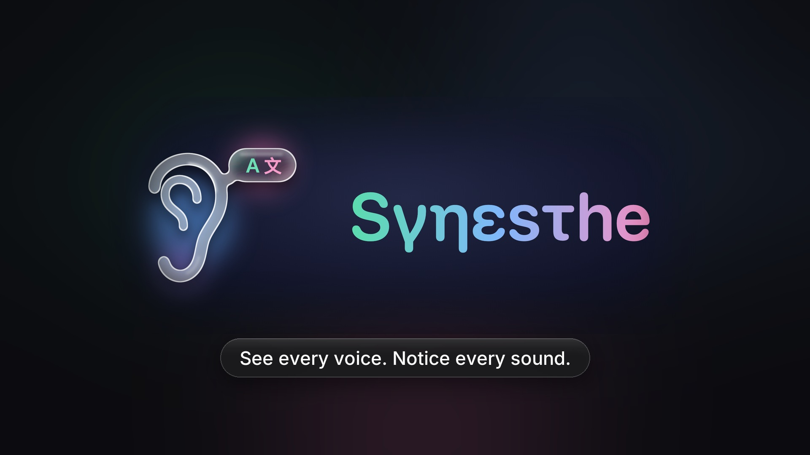 | 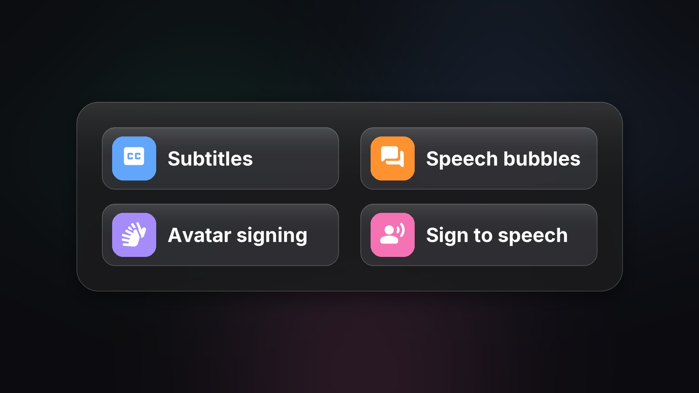 |
| 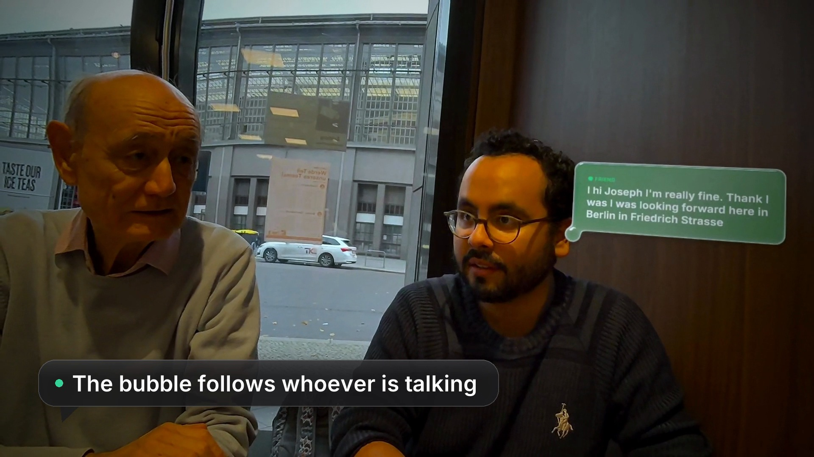 | 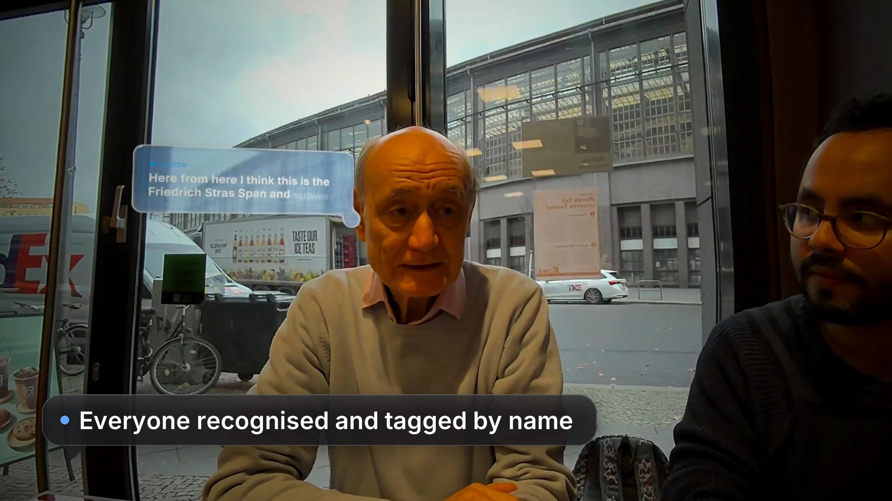 |
| 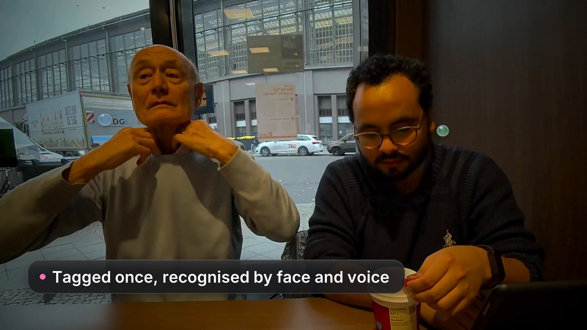 | 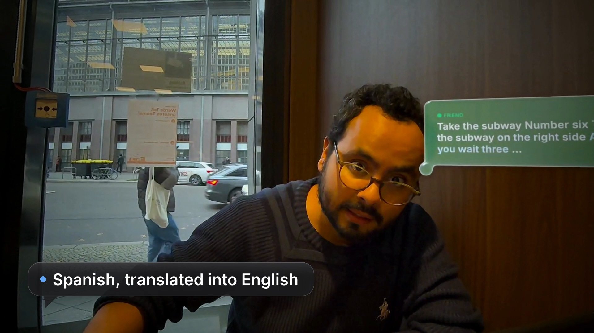 |
| 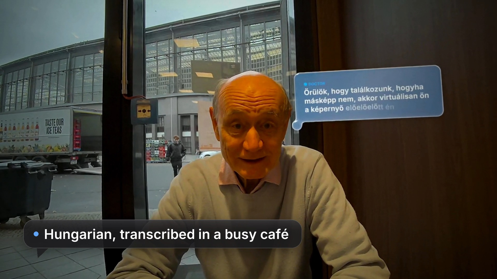 | 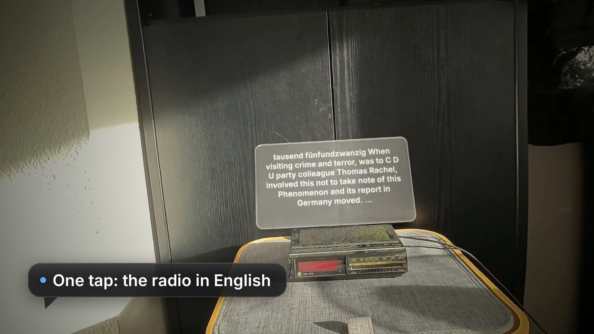 |
| 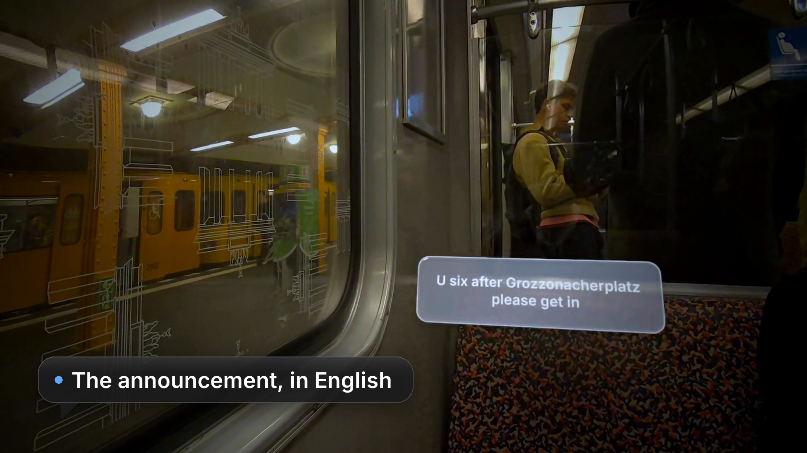 | 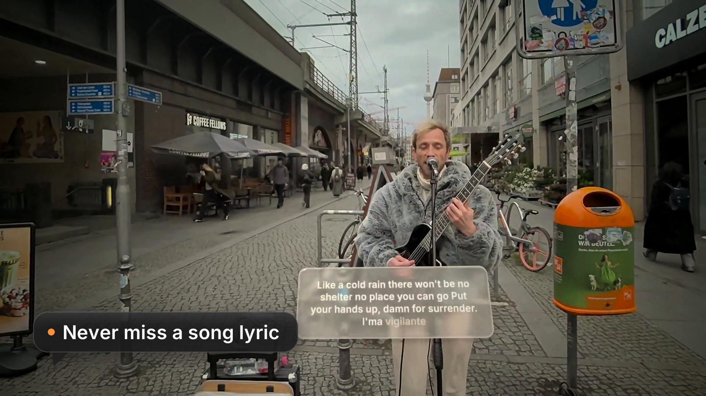 |
| 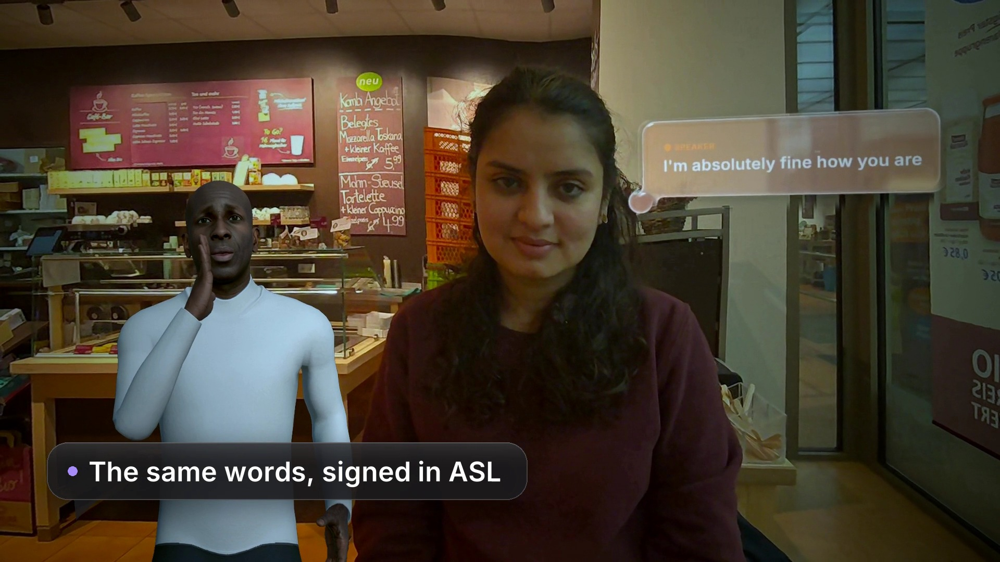 | 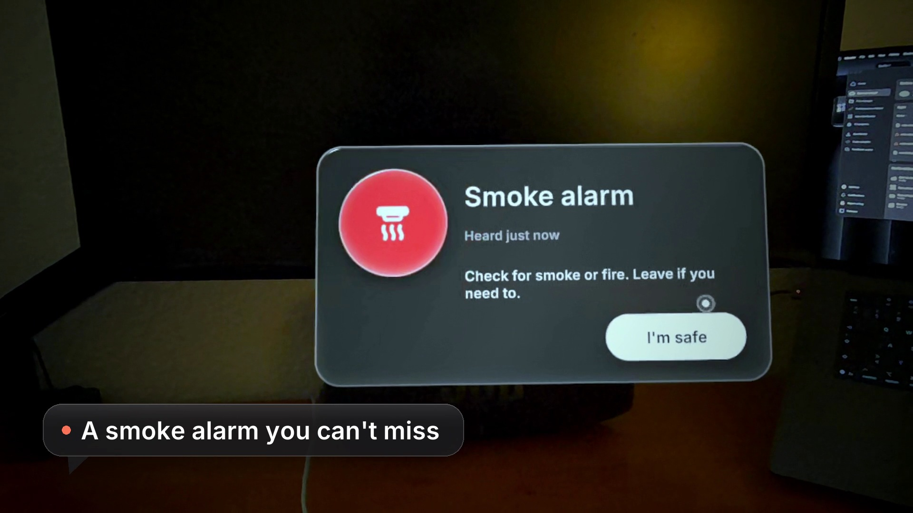 |
| 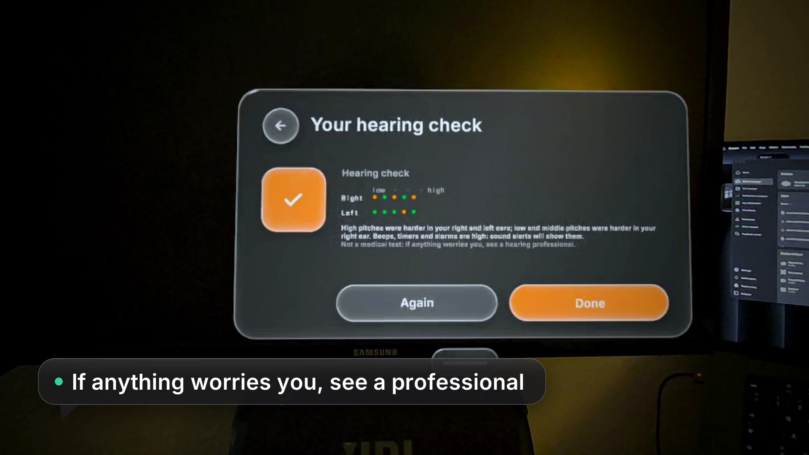 | 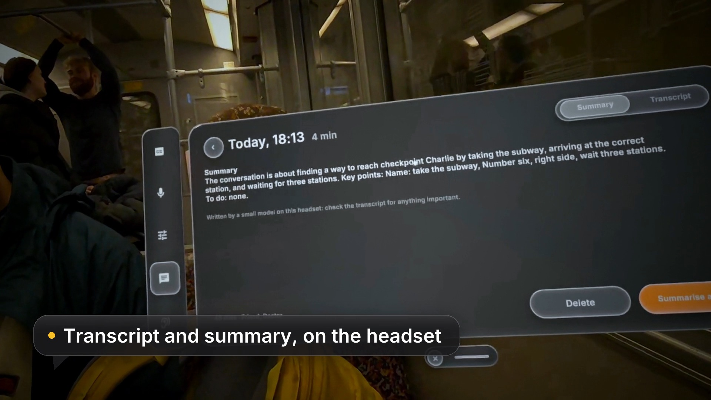 |
